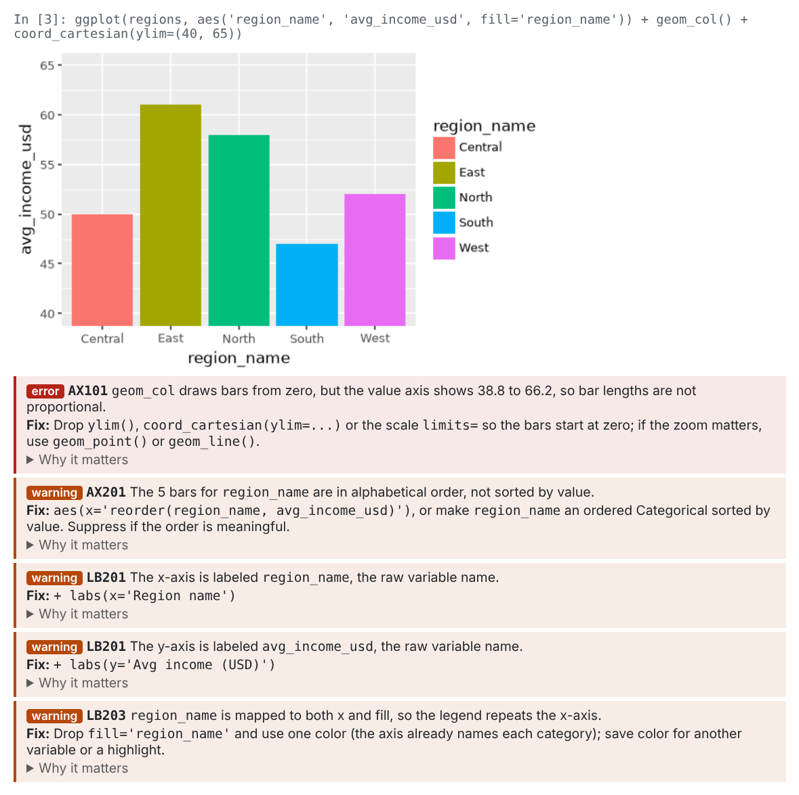

# plotnine-linter

**A teaching-first linter for plotnine and matplotlib charts.** It flags charts that mislead or that readers can't read. Each finding says why it matters in a sentence and gives a fix in the library the student is using. It also checks pandas and seaborn plots, because they draw with matplotlib.

The linter is strict only where a chart is objectively misleading or unreadable. Rules about taste are opt-in.



> **Status: prototype (v0.1).** 41 rules. The tests run on Python 3.10 to 3.13, plotnine 0.13 to 0.15, matplotlib 3.8 to 3.11 and seaborn 0.13. Public COGS 108 final projects served as calibration data (see [docs/calibration.md](docs/calibration.md)).

## Install

plotnine-linter isn't on PyPI yet. Install it from GitHub:

```bash
pip install "plotnine-linter[plotnine] @ git+https://github.com/snake-case-ggtext/plotnine-linter"
```

It supports Python ≥ 3.10 and matplotlib ≥ 3.8. plotnine (0.13 or later) is optional: leave out `[plotnine]` to lint only matplotlib, pandas and seaborn figures. To work on plotnine-linter itself, see [Contributing](#contributing).

## Jupyter in 30 seconds

Load the extension once. After that, the linter checks every plot when the notebook shows it, and the findings appear under the plot:

```python
%load_ext plotnine_linter
```

```python
%plotlint summary                  # every plot linted so far, with its findings
%plotlint rules                    # the rule catalog: %plotlint rules 1, %plotlint rules AX
%plotlint audit                    # Chartability audit of the last plot; add --markdown for a checklist
%plotlint profile accessibility    # Chartability and WCAG rules at their published thresholds
%plotlint select=tier1,tier2,tier3 # opt into the style rules
%plotlint off | on | status | reset
```

To break a rule on purpose, give the reason in a comment in the cell:

```python
# plotlint: ignore[AX201] survey questions are in the order we asked them
```

[`examples/demo.ipynb`](examples/demo.ipynb) walks through the main rules, the audit and the opt-in style rules.
For a two-minute live demo, open [`examples/demo_marimo.py`](examples/demo_marimo.py) with `uvx marimo edit --sandbox examples/demo_marimo.py`.

## What's in the package

`import plotnine_linter` gives you these names (`plotnine_linter.__all__`):

| Name | What it is |
|---|---|
| `lint` | lint a plotnine `ggplot`, or a matplotlib `Figure` or `Axes`; returns a `Report` |
| `audit` | a Chartability audit: a verdict for every test that applies to a static chart |
| `alt_text` | draft alt text for a chart |
| `data_table` | the data behind a chart, as a pandas DataFrame |
| `show_rules` | the rule catalog, showing which rules are on |
| `describe` | the chart description that the rules read (for writing rules) |
| `Report`, `Finding`, `Severity` | what `lint()` returns |
| `Config`, `load_config` | settings: selected rules, severities, thresholds, profiles |
| `RULES`, `all_rules` | the rule registry |
| `load_ipython_extension`, `unload_ipython_extension` | the Jupyter extension (`%load_ext plotnine_linter`) |

`plotnine_linter.testing.assert_clean(p)` fails a test or an autograder check when a plot has errors. The `plotnine-linter` command lints notebooks and scripts (`check`), writes accessibility checklists (`audit`) and lists the catalog (`rules`). [Getting started](docs/getting-started.md) shows each one.

## Rules

The ID encodes the area and the tier: `AX101` is an axes rule in tier 1. Tiers 1 and 2 run by default.

| Tier | Severity | Default | Rules |
| --- | --- | --- | --- |
| 1 Errors | error | on | AX101 truncated bars · AX102 dual y-axes · AX103 log scale drops data · CL101 rainbow colormap · CL102 too many colors · LB101 unlabeled numeric axis · LY101 overlapping tick labels · LY102 legend covers data · LY103 low-contrast text · MK101 overplotting · MK102 3D bars · MK103 line through unordered categories |
| 2 Clarity | warning | on | AX201 unsorted bars · AX202 rotated category labels · AX203 free facet scales · AX204 default histogram bins · AX205 months/weekdays/ratings in alphabetical order · AX206 log values on a linear axis *(heuristic)* · AX207 fractional ticks on whole numbers · CL201 colors confusable with color-vision deficiency · CL202 diverging data on a sequential scale · CL203 color that encodes nothing · CL204 low-contrast marks · LB201 raw variable names in labels, titles, facets · LB203 redundant legend · LB205 label doesn't match the values *(heuristic)* · LB206 scientific offset (1e8) · LY201 text too small · LY202 legend order ≠ line order · MK201 pie with many slices · MK202 spaghetti lines · MK203 summary bars without uncertainty · MK204 box plot hiding small groups · MK205 many stacked segments |
| 3 Style | info | opt-in | CL301 color is the only cue (grayscale) · LB301 no units *(heuristic)* · ST301 no title · ST303 direct labels would beat a legend · ST305 same category, different colors across figures · ST306 inconsistent themes across figures · ST307 excess tick precision |

A *heuristic* rule can't be certain, so it always reports **info**, whatever its tier. The [rule catalog](docs/rules.md) gives the why and the fix for each rule. The [gallery](docs/gallery.md) shows a before and after chart for each one.

## Documentation

| Page | What's in it |
|---|---|
| [Getting started](docs/getting-started.md) | Jupyter, `lint()` in code, autograders and the command line |
| [Configuration](docs/configuration.md) | `pyproject.toml` settings, severities, thresholds, profiles and suppressions |
| [Rule catalog](docs/rules.md) | Every rule, with why it matters and how to fix it |
| [Gallery](docs/gallery.md) | A broken chart and a fixed chart for every rule |
| [Accessibility](docs/accessibility.md) | The accessibility profile, the Chartability audit and how the rules map to Chartability and WCAG |
| [Calibration](docs/calibration.md) | How often each rule fired on public COGS 108 projects, and what changed as a result |
| [How it works](docs/design.md) | The chart description, the two adapters, the catalog and the known limits |

## Contributing

Bug reports, rule ideas and false alarms are all welcome. See [CONTRIBUTING.md](CONTRIBUTING.md) for the development setup, the tests and how to add a rule. In short:

```bash
make install   # uv sync and the git hooks
make test      # the tests, in random order, with coverage
make lint      # ruff, pyrefly and slop-lint
```

## License

MIT. See [LICENSE](LICENSE).
