# Before / after gallery

One broken chart and one fixed chart for every rule in the catalog. Each *before* plot is flagged by `plotnine_linter.lint()` for its rule; each *after* plot follows the rule's fix and lints clean with the default rules (tiers 1 and 2) plus the example's own rule selected.

Generated by [`docs/gallery/make_gallery.py`](gallery/make_gallery.py), which runs every snippet below and fails if a before plot isn't flagged or an after plot is. Don't edit this file by hand: change the script and rerun `python docs/gallery/make_gallery.py`.

Every snippet starts from:

```python
import numpy as np
import pandas as pd
import matplotlib.pyplot as plt
import seaborn as sns
from plotnine import *
from mizani.labels import label_percent


def plain(breaks):  # tick labels like 0.1, 10, 1,000 instead of 1e-1, 1e1, 1e3
    return [f"{b:,g}" for b in breaks]


OKABE = [
    "#E69F00",
    "#56B4E9",
    "#009E73",
    "#F0E442",
    "#0072B2",
    "#D55E00",
    "#CC79A7",
    "#000000",
]
rng = np.random.default_rng(2026)
```

Figures are 5 x 3.5 in (`plotnine.options.figure_size`, or `figure.figsize` with constrained layout for matplotlib).

- **Tier 1, Errors** (error): [AX101](#ax101) · [AX102](#ax102) · [AX103](#ax103) · [CL101](#cl101) · [CL102](#cl102) · [LB101](#lb101) · [LY101](#ly101) · [LY102](#ly102) · [LY103](#ly103) · [MK101](#mk101) · [MK102](#mk102) · [MK103](#mk103)
- **Tier 2, Clarity** (warning): [AX201](#ax201) · [AX202](#ax202) · [AX203](#ax203) · [AX204](#ax204) · [AX205](#ax205) · [AX206](#ax206) · [AX207](#ax207) · [CL201](#cl201) · [CL202](#cl202) · [CL203](#cl203) · [CL204](#cl204) · [LB201](#lb201) · [LB203](#lb203) · [LB205](#lb205) · [LB206](#lb206) · [LY201](#ly201) · [LY202](#ly202) · [MK201](#mk201) · [MK202](#mk202) · [MK203](#mk203) · [MK204](#mk204) · [MK205](#mk205)
- **Tier 3, Style** (info): [CL301](#cl301) · [LB301](#lb301) · [ST301](#st301) · [ST303](#st303) · [ST305](#st305) · [ST306](#st306) · [ST307](#st307)

## Tier 1: Errors (error, on by default)

<a id="ax101"></a>

### AX101 — Bar or area axis excludes zero

A bar's length encodes its value.

| Before | After |
| --- | --- |
| 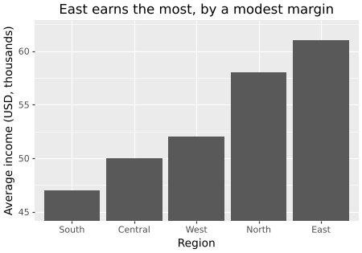 | 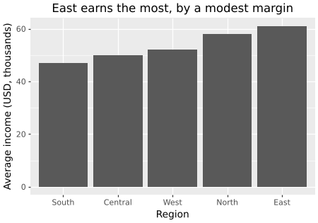 |

Zoomed in, East's bar is several times South's; from zero, the bars show it is about 30% more.

**What the linter says about the before plot:**

```text
AX101 error: `geom_col` draws bars from zero, but the value axis shows 44.1 to 62.9, so bar lengths are not proportional.
    fix: Drop `ylim()`, `coord_cartesian(ylim=...)` or the scale `limits=` so the bars start at zero; if the zoom matters, use `geom_point()` or `geom_line()`.
```

**The fix:**

```diff
  p = (ggplot(income, aes("reorder(region, income)", "income"))
       + geom_col()
-      + coord_cartesian(ylim=(45, 62))
       + labs(x="Region", y="Average income (USD, thousands)",
              title="East earns the most, by a modest margin"))
```

<details><summary>Data for this example</summary>

```python
income = pd.DataFrame(
    {
        "region": ["West", "East", "South", "North", "Central"],
        "income": [52, 61, 47, 58, 50],
    }
)
```

</details>

<a id="ax102"></a>

### AX102 — Dual y-axes

Two independent scales on one panel make the crossing points and relative slopes arbitrary: rescale either axis and the story changes.

| Before | After |
| --- | --- |
| 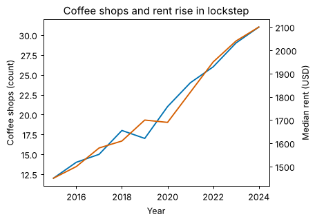 | 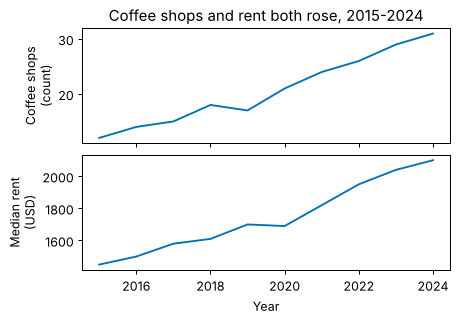 |

With two y-axes the lines can be made to cross anywhere by rescaling one axis; stacked panels with a shared x-axis show each trend on its own honest scale.

**What the linter says about the before plot:**

```text
AX102 error (panel 2): This figure overlays two axes with independent scales (`twinx`/`twiny`).
    fix: Use `fig, (ax1, ax2) = plt.subplots(2, 1, sharex=True)`, or index both series (e.g. percent change from the first value) and plot them on one axis.
```

**The fix:**

```diff
- fig, ax = plt.subplots()
+ fig, (ax, ax2) = plt.subplots(2, 1, sharex=True)
  ax.plot(years, cafes, color=OKABE[4])
- ax.set_ylabel("Coffee shops (count)")
+ ax.set_ylabel("Coffee shops\n(count)")
- ax2 = ax.twinx()
- ax2.plot(years, rent, color=OKABE[5])
+ ax2.plot(years, rent, color=OKABE[4])
- ax2.set_ylabel("Median rent (USD)")
+ ax2.set_ylabel("Median rent\n(USD)")
- ax.set_xlabel("Year")
+ ax2.set_xlabel("Year")
- ax.set_title("Coffee shops and rent rise in lockstep")
+ ax.set_title("Coffee shops and rent both rose, 2015-2024")
  p = fig
```

<details><summary>Data for this example</summary>

```python
years = np.arange(2015, 2025)
cafes = np.array([12, 14, 15, 18, 17, 21, 24, 26, 29, 31])
rent = np.array([1450, 1500, 1580, 1610, 1700, 1690, 1820, 1950, 2040, 2100])
```

</details>

<a id="ax103"></a>

### AX103 — Log scale silently drops data

Zero and negative values have no logarithm.

| Before | After |
| --- | --- |
| 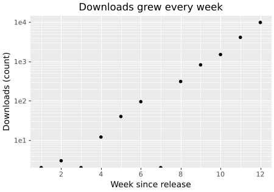 | 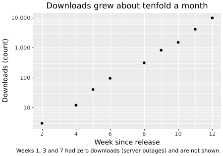 |

The log axis silently drops weeks 1, 3 and 7 (zero downloads), so the before title is wrong. The after plot drops them on purpose and says so in a caption.

**What the linter says about the before plot:**

```text
AX103 error: The y-axis is log-scaled, but `downloads` has 3 values at or below zero; they are not shown.
    fix: Use `scale_y_continuous(trans='pseudo_log')`, or filter those rows and say so in the caption.
```

**The fix:**

```diff
- p = (ggplot(pkg, aes("week", "downloads"))
+ p = (ggplot(pkg[pkg["downloads"] > 0], aes("week", "downloads"))
       + geom_point()
       + scale_x_continuous(breaks=range(2, 13, 2))
-      + scale_y_log10()
+      + scale_y_log10(labels=plain)
       + labs(x="Week since release", y="Downloads (count)",
-             title="Downloads grew every week"))
+             title="Downloads grew about tenfold a month",
+             caption="Weeks 1, 3 and 7 had zero downloads (server outages) and are not shown."))
```

<details><summary>Data for this example</summary>

```python
pkg = pd.DataFrame(
    {
        "week": range(1, 13),
        "downloads": [0, 3, 0, 12, 40, 95, 0, 310, 820, 1500, 4100, 9800],
    }
)
```

</details>

<a id="cl101"></a>

### CL101 — Rainbow colormap for ordered data

Rainbow colormaps aren't perceptually ordered: brightness jumps create false boundaries, and they fail for readers with color-vision deficiency.

| Before | After |
| --- | --- |
| 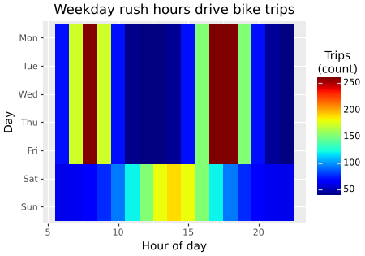 | 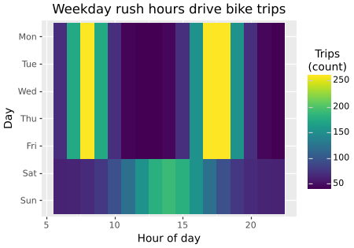 |

In `jet`, the bright yellow-cyan band looks like a sharp boundary that isn't in the data; `viridis` gets steadily lighter as trips increase.

**What the linter says about the before plot:**

```text
CL101 error: `scale_fill_cmap` uses the rainbow colormap `jet`.
    fix: `scale_fill_cmap('viridis')` for sequential data, or `scale_fill_cmap('RdBu')` with a meaningful midpoint.
```

**The fix:**

```diff
  p = (ggplot(trips, aes("hour", "day", fill="trips"))
       + geom_tile()
-      + scale_fill_cmap("jet")
+      + scale_fill_cmap("viridis")
       + labs(x="Hour of day", y="Day", fill="Trips\n(count)",
              title="Weekday rush hours drive bike trips"))
```

<details><summary>Data for this example</summary>

```python
days = ["Mon", "Tue", "Wed", "Thu", "Fri", "Sat", "Sun"]
trips = pd.DataFrame(
    [(d, h) for d in days for h in range(6, 23)], columns=["day", "hour"]
)
weekday = trips["day"].isin(days[:5])
trips["trips"] = np.where(
    weekday,
    40
    + 220 * np.exp(-((trips.hour - 8) ** 2) / 2)
    + 240 * np.exp(-((trips.hour - 17.5) ** 2) / 3),
    60 + 130 * np.exp(-((trips.hour - 14) ** 2) / 12),
).round()
trips["day"] = pd.Categorical(trips["day"], categories=days[::-1], ordered=True)
```

</details>

<a id="cl102"></a>

### CL102 — Too many categorical colors

Readers can reliably match only about eight hues to a legend; beyond that, colors repeat or become too similar to tell apart.

| Before | After |
| --- | --- |
| 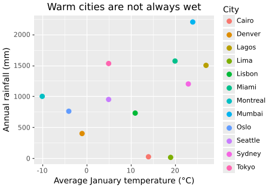 | 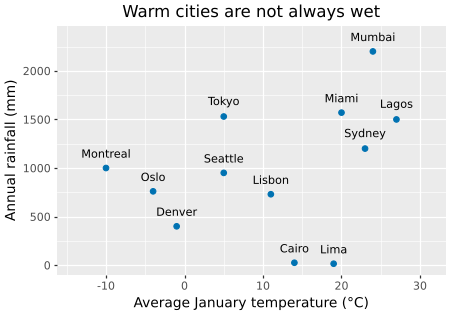 |

Twelve hues can't be matched back to a legend; with one point per city, labeling the points does the job.

**What the linter says about the before plot:**

```text
CL102 error: `city` maps 12 categories to color; more than 8 hues can't be told apart.
    fix: Lump rare levels into 'Other', highlight a few and gray the rest, or `facet_wrap('city')`.
```

The before plot also trips [CL201](#cl201).

**The fix:**

```diff
- p = (ggplot(cities, aes("jan_temp", "rain", color="city"))
+ p = (ggplot(cities, aes("jan_temp", "rain"))
-      + geom_point(size=3)
+      + geom_point(size=2, color=OKABE[4])
+      + geom_text(aes(label="city"), nudge_y=150, size=9)
+      + expand_limits(x=(-14, 31))
       + labs(x="Average January temperature (°C)", y="Annual rainfall (mm)",
-             color="City", title="Warm cities are not always wet"))
+             title="Warm cities are not always wet"))
```

<details><summary>Data for this example</summary>

```python
cities = pd.DataFrame(
    {
        "city": [
            "Oslo",
            "Lisbon",
            "Cairo",
            "Lagos",
            "Mumbai",
            "Tokyo",
            "Sydney",
            "Lima",
            "Montreal",
            "Denver",
            "Miami",
            "Seattle",
        ],
        "jan_temp": [-4, 11, 14, 27, 24, 5, 23, 19, -10, -1, 20, 5],
        "rain": [760, 730, 25, 1500, 2200, 1530, 1200, 15, 1000, 400, 1570, 950],
    }
)
```

</details>

<a id="lb101"></a>

### LB101 — Quantitative axis has no label

Without a label the reader can't tell what is measured or in what units.

| Before | After |
| --- | --- |
| 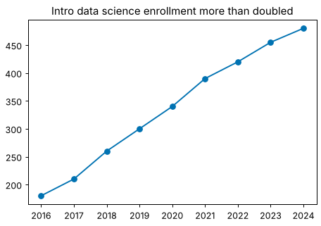 | 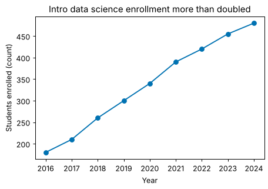 |

**What the linter says about the before plot:**

```text
LB101 error: The x-axis shows numbers but has no label.
    fix: `ax.set_xlabel('What is measured (units)')`
LB101 error: The y-axis shows numbers but has no label.
    fix: `ax.set_ylabel('What is measured (units)')`
```

**The fix:**

```diff
  fig, ax = plt.subplots()
  ax.plot(years, students, marker="o", color=OKABE[4])
+ ax.set_xlabel("Year")
+ ax.set_ylabel("Students enrolled (count)")
  ax.set_title("Intro data science enrollment more than doubled")
  p = fig
```

<details><summary>Data for this example</summary>

```python
years = np.arange(2016, 2025)
students = [180, 210, 260, 300, 340, 390, 420, 455, 480]
```

</details>

<a id="ly101"></a>

### LY101 — Overlapping tick labels

Overlapping labels can't be read, so the axis stops doing its job.

| Before | After |
| --- | --- |
| 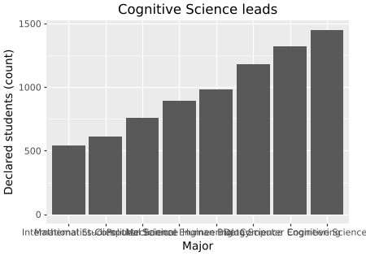 | 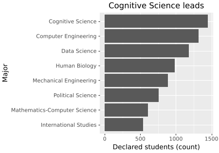 |

**What the linter says about the before plot:**

```text
LY101 error: 7 pair(s) of x-axis tick labels overlap (e.g. 'International S…' and 'Mathematics-Com…').
    fix: Swap axes with `coord_flip()` so labels read horizontally; otherwise fewer breaks or shorter labels. Rotation isn't a fix (see AX202).
```

**The fix:**

```diff
  p = (ggplot(majors, aes("reorder(major, students)", "students"))
       + geom_col()
+      + coord_flip()
       + labs(x="Major", y="Declared students (count)",
              title="Cognitive Science leads"))
```

<details><summary>Data for this example</summary>

```python
majors = pd.DataFrame(
    {
        "major": [
            "Cognitive Science",
            "Computer Engineering",
            "Data Science",
            "Political Science",
            "Human Biology",
            "Mechanical Engineering",
            "International Studies",
            "Mathematics-Computer Science",
        ],
        "students": [1450, 1320, 1180, 760, 980, 890, 540, 610],
    }
)
```

</details>

<a id="ly102"></a>

### LY102 — Legend covers data

A legend drawn over the data hides exactly the marks the reader is trying to see.

| Before | After |
| --- | --- |
| 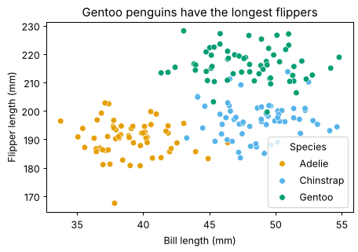 | 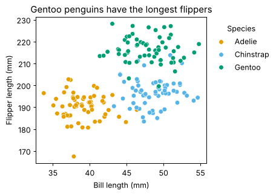 |

Naming the columns the way the axis labels should read saves a `set_xlabel` call in seaborn.

**What the linter says about the before plot:**

```text
LY102 error: The legend sits on top of 2 data point(s).
    fix: Move it outside: `ax.legend(loc='upper left', bbox_to_anchor=(1.01, 1))`, or label series directly with `ax.annotate`.
```

**The fix:**

```diff
  fig, ax = plt.subplots()
  sns.scatterplot(birds, x="Bill length (mm)", y="Flipper length (mm)",
                  hue="Species", palette=OKABE[:3], ax=ax)
- sns.move_legend(ax, "lower right")
+ sns.move_legend(ax, "upper left", bbox_to_anchor=(1, 1), frameon=False)
  ax.set_title("Gentoo penguins have the longest flippers")
  p = fig
```

<details><summary>Data for this example</summary>

```python
n = 60
birds = pd.DataFrame(
    {
        "Species": np.repeat(["Adelie", "Chinstrap", "Gentoo"], n),
        "Bill length (mm)": np.concatenate(
            [rng.normal(m, 2.5, n) for m in (38.5, 49, 47.5)]
        ),
        "Flipper length (mm)": np.concatenate(
            [rng.normal(m, 6, n) for m in (190, 196, 217)]
        ),
    }
)
```

</details>

<a id="ly103"></a>

### LY103 — Low-contrast text

Text that is too close in brightness to its background can't be read by people with low vision, on a projector, or in sunlight.

| Before | After |
| --- | --- |
| 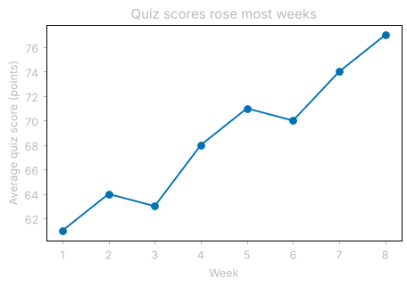 | 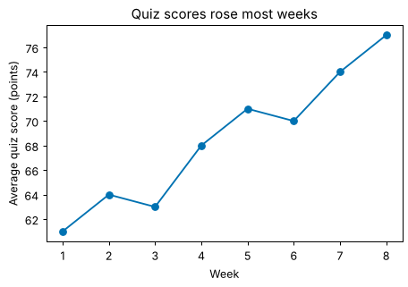 |

Light gray text on white is about 1.9:1; WCAG asks 4.5:1 for normal text.

**What the linter says about the before plot:**

```text
LY103 error: Text 'Week' (xlabel) has a contrast of 1.9:1 against its background; it needs 4.5:1.
    fix: Darken it (`color='#222222'`), or lighten what is behind it.
```

**The fix:**

```diff
  fig, ax = plt.subplots()
  ax.plot(scores.week, scores.score, color=OKABE[4], marker="o")
- ax.set_xlabel("Week", color="#bbbbbb")
+ ax.set_xlabel("Week")
- ax.set_ylabel("Average quiz score (points)", color="#bbbbbb")
+ ax.set_ylabel("Average quiz score (points)")
- ax.tick_params(colors="#bbbbbb")
- ax.set_title("Quiz scores rose most weeks", color="#bbbbbb")
+ ax.set_title("Quiz scores rose most weeks")
  p = fig
```

<details><summary>Data for this example</summary>

```python
scores = pd.DataFrame({"week": range(1, 9), "score": [61, 64, 63, 68, 71, 70, 74, 77]})
```

</details>

<a id="mk101"></a>

### MK101 — Overplotting

When many points land on top of each other, density becomes invisible: a thousand points in one spot look the same as one.

| Before | After |
| --- | --- |
| 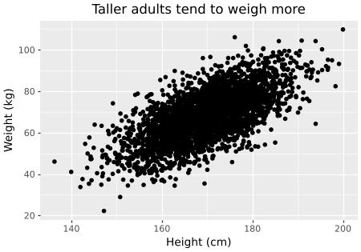 | 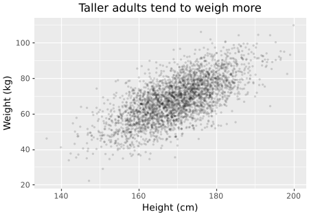 |

At full opacity the center is a solid blob; with transparency the dense core is visible.

**What the linter says about the before plot:**

```text
MK101 error: 87% of the 3000 points overlap another point at full opacity.
    fix: `geom_point(alpha=0.3)`, or `geom_bin_2d()` for very large data.
```

**The fix:**

```diff
  p = (ggplot(people, aes("height", "weight"))
-      + geom_point()
+      + geom_point(alpha=0.15, stroke=0)
       + labs(x="Height (cm)", y="Weight (kg)",
              title="Taller adults tend to weigh more"))
```

<details><summary>Data for this example</summary>

```python
n = 3000
height = rng.normal(170, 9, n)
people = pd.DataFrame(
    {"height": height, "weight": 0.9 * height - 85 + rng.normal(0, 9, n)}
)
```

</details>

<a id="mk102"></a>

### MK102 — 3D for 2D data

Perspective distorts length and area, and bars hide behind each other; the third dimension adds no information.

| Before | After |
| --- | --- |
| 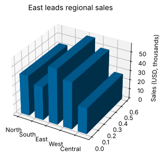 | 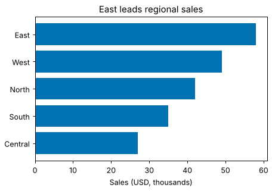 |

**What the linter says about the before plot:**

```text
MK102 error: This chart draws bars in 3D (`bar3d`).
    fix: Use grouped 2D bars, or a heatmap (`ax.imshow` / `seaborn.heatmap`) for two categorical dimensions.
```

**The fix:**

```diff
+ s = sales.sort_values()
+ fig, ax = plt.subplots()
+ ax.barh(s.index, s.values, color=OKABE[4])
- fig = plt.figure()
- ax = fig.add_subplot(projection="3d")
- ax.bar3d(range(5), 0, 0, 0.6, 0.6, sales.values, color=OKABE[4])
- ax.set_xticks(range(5), sales.index)
- ax.set_zlabel("Sales (USD, thousands)")
+ ax.set_xlabel("Sales (USD, thousands)")
  ax.set_title("East leads regional sales")
  p = fig
```

<details><summary>Data for this example</summary>

```python
sales = pd.Series({"North": 42, "South": 35, "East": 58, "West": 49, "Central": 27})
```

</details>

<a id="mk103"></a>

### MK103 — Line connects unordered categories

A line implies continuity and order between neighboring points.

| Before | After |
| --- | --- |
| 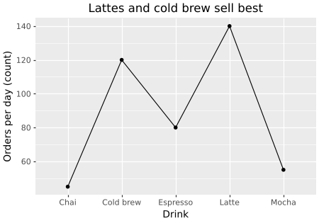 | 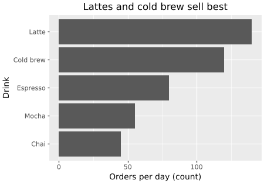 |

The line's ups and downs only reflect alphabetical order; drinks have no order between them.

**What the linter says about the before plot:**

```text
MK103 error: `geom_line` connects the unordered categories of `drink`.
    fix: Use `geom_point()` or `geom_col()`; if the categories are ordered, make the column an ordered Categorical and suppress this rule.
```

**The fix:**

```diff
- p = (ggplot(drinks, aes("drink", "orders", group=1))
+ p = (ggplot(drinks, aes("reorder(drink, orders)", "orders"))
-      + geom_line()
+      + geom_col()
-      + geom_point()
+      + coord_flip()
       + labs(x="Drink", y="Orders per day (count)",
              title="Lattes and cold brew sell best"))
```

<details><summary>Data for this example</summary>

```python
drinks = pd.DataFrame(
    {
        "drink": ["Latte", "Mocha", "Espresso", "Cold brew", "Chai"],
        "orders": [140, 55, 80, 120, 45],
    }
)
```

</details>

## Tier 2: Clarity (warning, on by default)

<a id="ax201"></a>

### AX201 — Unsorted bars on a nominal axis

With nominal categories, the reader's question is usually 'which is biggest?'.

| Before | After |
| --- | --- |
| 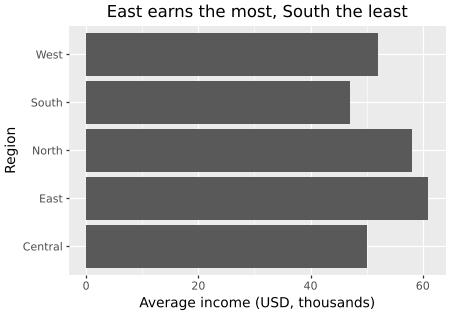 | 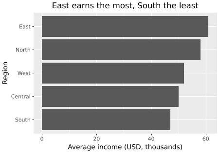 |

**What the linter says about the before plot:**

```text
AX201 warning: The 5 bars for `region` are in alphabetical order, not sorted by value.
    fix: `aes(x='reorder(region, income)')`, or make `region` an ordered Categorical sorted by value. Suppress if the order is meaningful.
```

**The fix:**

```diff
- p = (ggplot(income, aes("region", "income"))
+ p = (ggplot(income, aes("reorder(region, income)", "income"))
       + geom_col()
       + coord_flip()
       + labs(x="Region", y="Average income (USD, thousands)",
              title="East earns the most, South the least"))
```

<details><summary>Data for this example</summary>

```python
income = pd.DataFrame(
    {
        "region": ["West", "East", "South", "North", "Central"],
        "income": [52, 61, 47, 58, 50],
    }
)
```

</details>

<a id="ax202"></a>

### AX202 — Rotated or crowded category labels

Tilted text is slow to read, even at 30°.

| Before | After |
| --- | --- |
| 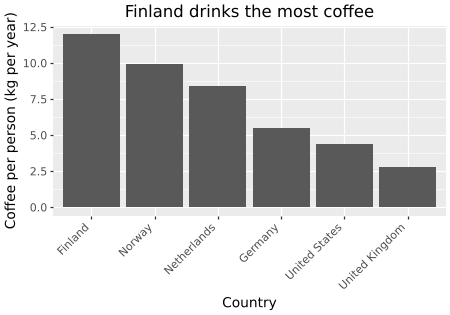 | 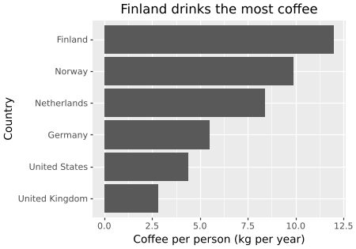 |

**What the linter says about the before plot:**

```text
AX202 warning: Category labels on the x-axis are rotated 45° (e.g. 'Finland').
    fix: Swap the axes with `coord_flip()` so the labels read horizontally.
```

**The fix:**

```diff
- p = (ggplot(coffee, aes("reorder(country, -kg)", "kg"))
+ p = (ggplot(coffee, aes("reorder(country, kg)", "kg"))
       + geom_col()
-      + theme(axis_text_x=element_text(rotation=45, ha="right"))
+      + coord_flip()
       + labs(x="Country", y="Coffee per person (kg per year)",
              title="Finland drinks the most coffee"))
```

<details><summary>Data for this example</summary>

```python
coffee = pd.DataFrame(
    {
        "country": [
            "Finland",
            "Norway",
            "Netherlands",
            "Germany",
            "United States",
            "United Kingdom",
        ],
        "kg": [12.0, 9.9, 8.4, 5.5, 4.4, 2.8],
    }
)
```

</details>

<a id="ax203"></a>

### AX203 — Free facet scales

Panels side by side invite comparison.

| Before | After |
| --- | --- |
| 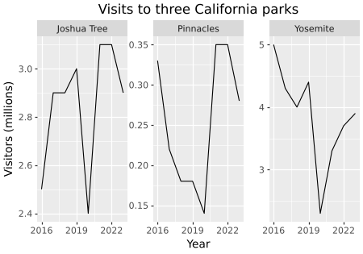 | 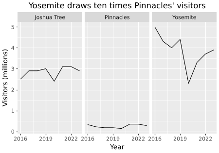 |

With free scales, Pinnacles' line looks as big as Yosemite's; on a shared scale the gap is clear.

**What the linter says about the before plot:**

```text
AX203 warning: Facets use `scales='free_y'`, so panels aren't on a common y scale.
    fix: Drop `scales=` to share axes, or note in the title or caption that each panel has its own scale.
```

**The fix:**

```diff
  p = (ggplot(parks, aes("year", "visitors"))
       + geom_line()
-      + facet_wrap("park", scales="free_y")
+      + facet_wrap("park")
       + scale_x_continuous(breaks=[2016, 2019, 2022])
       + labs(x="Year", y="Visitors (millions)",
-             title="Visits to three California parks"))
+             title="Yosemite draws ten times Pinnacles' visitors"))
```

<details><summary>Data for this example</summary>

```python
parks = pd.DataFrame(
    {
        "year": np.tile(np.arange(2016, 2024), 3),
        "park": np.repeat(["Yosemite", "Joshua Tree", "Pinnacles"], 8),
        "visitors": [
            5.0,
            4.3,
            4.0,
            4.4,
            2.3,
            3.3,
            3.7,
            3.9,
            2.5,
            2.9,
            2.9,
            3.0,
            2.4,
            3.1,
            3.1,
            2.9,
            0.33,
            0.22,
            0.18,
            0.18,
            0.14,
            0.35,
            0.35,
            0.28,
        ],
    }
)
```

</details>

<a id="ax204"></a>

### AX204 — Default histogram bins

A histogram's shape depends on its bins.

| Before | After |
| --- | --- |
| 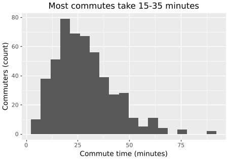 | 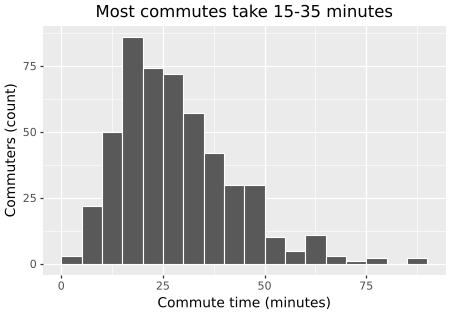 |

Five-minute bins starting at zero mean something to a reader; plotnine's default 30 bins don't.

**What the linter says about the before plot:**

```text
AX204 warning: `geom_histogram` uses plotnine's automatic bins.
    fix: Set a meaningful width, e.g. `geom_histogram(binwidth=5)` for 5-year age bands.
```

**The fix:**

```diff
  p = (ggplot(commute, aes("minutes"))
-      + geom_histogram()
+      + geom_histogram(binwidth=5, boundary=0, color="white")
       + labs(x="Commute time (minutes)", y="Commuters (count)",
              title="Most commutes take 15-35 minutes"))
```

<details><summary>Data for this example</summary>

```python
commute = pd.DataFrame({"minutes": rng.gamma(4, 7, 500)})
```

</details>

<a id="ax205"></a>

### AX205 — Ordered categories in alphabetical order

Months, weekdays and rating scales have a natural order.

| Before | After |
| --- | --- |
| 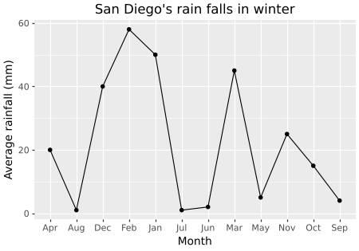 | 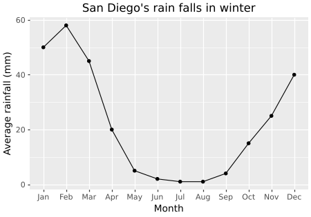 |

**What the linter says about the before plot:**

```text
AX205 warning: `month` is shown in alphabetical order (Apr, Aug, Dec, Feb…) instead of its natural order (Jan, Feb, Mar, Apr…).
    fix: `df['month'] = pd.Categorical(df['month'], categories=['Jan', 'Feb', 'Mar', 'Apr', 'May', 'Jun', 'Jul', 'Aug', 'Sep', 'Oct', 'Nov', 'Dec'], ordered=True)` before plotting.
```

**The fix:**

```diff
+ rain["month"] = pd.Categorical(rain["month"], categories=MONTHS, ordered=True)
  p = (ggplot(rain, aes("month", "mm", group=1))
       + geom_line()
       + geom_point()
       + labs(x="Month", y="Average rainfall (mm)",
              title="San Diego's rain falls in winter"))
```

<details><summary>Data for this example</summary>

```python
MONTHS = [
    "Jan",
    "Feb",
    "Mar",
    "Apr",
    "May",
    "Jun",
    "Jul",
    "Aug",
    "Sep",
    "Oct",
    "Nov",
    "Dec",
]
rain = pd.DataFrame(
    {"month": MONTHS, "mm": [50, 58, 45, 20, 5, 2, 1, 1, 4, 15, 25, 40]}
)
```

</details>

<a id="ax206"></a>

### AX206 — Log values on a linear axis

Plotting log-transformed values on a linear axis makes readers decode logarithms (what is 4.7?).

| Before | After |
| --- | --- |
| 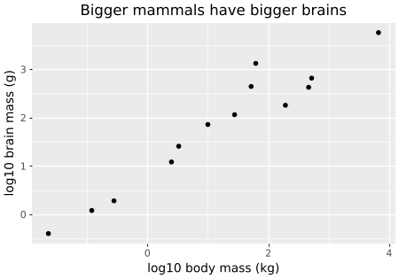 | 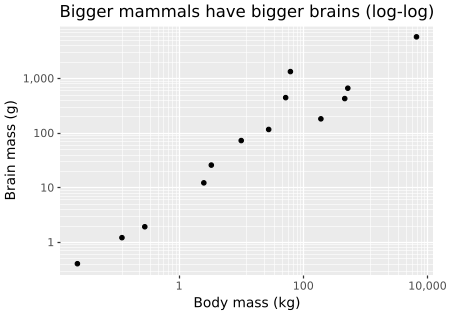 |

Is a brain at 2.5 big? On a log-scaled axis the ticks read 1, 10, 100 g instead.

**What the linter says about the before plot:**

```text
AX206 info: The x-axis shows log-transformed values ('log10 body mass (kg)') on a linear scale.
    fix: Map the original column and add `scale_x_log10()`.
```

**The fix:**

```diff
- p = (ggplot(mammals, aes("np.log10(body_kg)", "np.log10(brain_g)"))
+ p = (ggplot(mammals, aes("body_kg", "brain_g"))
       + geom_point()
+      + scale_x_log10(labels=plain)
+      + scale_y_log10(labels=plain)
-      + labs(x="log10 body mass (kg)", y="log10 brain mass (g)",
+      + labs(x="Body mass (kg)", y="Brain mass (g)",
-             title="Bigger mammals have bigger brains"))
+             title="Bigger mammals have bigger brains (log-log)"))
```

<details><summary>Data for this example</summary>

```python
mammals = pd.DataFrame(
    {
        "animal": [
            "Mouse",
            "Mole",
            "Rat",
            "Rabbit",
            "Cat",
            "Dog",
            "Goat",
            "Chimpanzee",
            "Human",
            "Pig",
            "Cow",
            "Horse",
            "Elephant",
        ],
        "body_kg": [0.023, 0.12, 0.28, 2.5, 3.3, 10, 27.7, 52, 62, 192, 465, 521, 6654],
        "brain_g": [0.4, 1.2, 1.9, 12.1, 25.6, 72, 115, 440, 1320, 180, 423, 655, 5712],
    }
)
```

</details>

<a id="ax207"></a>

### AX207 — Fractional ticks on whole-number data

Ticks like 2017.5 on years, or 2.5 on a count of people, label values the data can't take and make the chart look careless.

| Before | After |
| --- | --- |
| 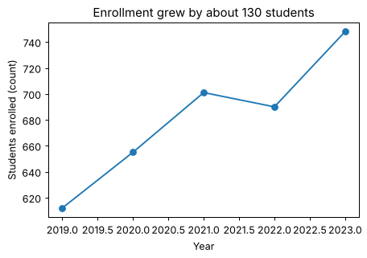 | 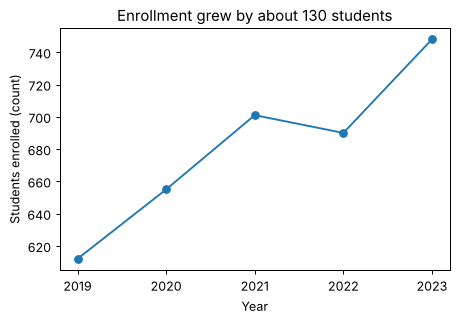 |

Matplotlib picks ticks like 2019.5 for a handful of years; there is no half-year in the data.

**What the linter says about the before plot:**

```text
AX207 warning: The x-axis has a tick at 2018.5, but the plotted values are whole numbers.
    fix: `from matplotlib.ticker import MaxNLocator`; `ax.xaxis.set_major_locator(MaxNLocator(integer=True))`.
```

**The fix:**

```diff
+ from matplotlib.ticker import MaxNLocator
  fig, ax = plt.subplots()
  ax.plot(enrollment.year, enrollment.students, marker="o")
+ ax.xaxis.set_major_locator(MaxNLocator(integer=True))
  ax.set(xlabel="Year", ylabel="Students enrolled (count)",
         title="Enrollment grew by about 130 students")
  p = fig
```

<details><summary>Data for this example</summary>

```python
enrollment = pd.DataFrame(
    {"year": [2019, 2020, 2021, 2022, 2023], "students": [612, 655, 701, 690, 748]}
)
```

</details>

<a id="cl201"></a>

### CL201 — Colors indistinguishable with color-vision deficiency

About 1 in 12 men and 1 in 200 women have a color-vision deficiency, most often red-green.

| Before | After |
| --- | --- |
| 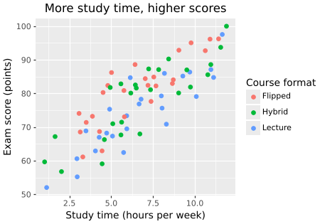 | 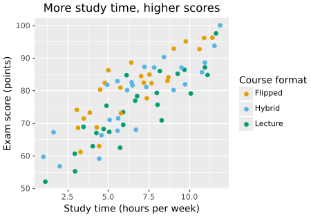 |

plotnine's default hues for three groups are hard to tell apart under deuteranopia; the Okabe-Ito palette was designed to stay distinct.

**What the linter says about the before plot:**

```text
CL201 warning: With deuteranopia, the colors for 'Flipped' and 'Hybrid' look nearly the same (ΔE2000 6; 1 confusable pair(s) in total).
    fix: `scale_color_manual(values=["#E69F00", "#56B4E9", "#009E73", "#0072B2", "#D55E00", "#CC79A7", "#000000"])`, or also map `shape` (points) or `linetype` (lines) to the same variable.
```

**The fix:**

```diff
  p = (ggplot(study, aes("hours", "score", color="format"))
       + geom_point(size=2)
+      + scale_color_manual(values=OKABE[:3])
       + labs(x="Study time (hours per week)", y="Exam score (points)",
              color="Course format", title="More study time, higher scores"))
```

<details><summary>Data for this example</summary>

```python
n = 25
hours = rng.uniform(1, 12, 3 * n)
study = pd.DataFrame(
    {
        "format": np.repeat(["Lecture", "Flipped", "Hybrid"], n),
        "hours": hours,
        "score": np.clip(
            55 + 3 * hours + np.repeat([0, 6, 3], n) + rng.normal(0, 5, 3 * n), 0, 100
        ),
    }
)
```

</details>

<a id="cl202"></a>

### CL202 — Diverging data on a sequential color scale

When values run from negative to positive (correlations, changes, residuals), zero is the meaningful middle.

| Before | After |
| --- | --- |
| 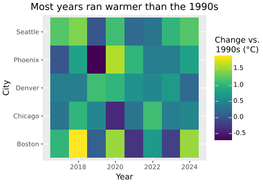 | 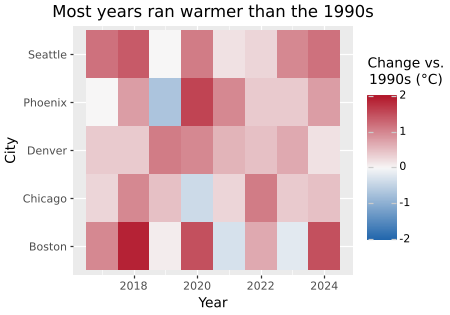 |

On the sequential scale, a cooler-than-usual year (negative change) is just 'darker blue'; centered at zero, warm and cool years are red and blue.

**What the linter says about the before plot:**

```text
CL202 warning: `change` runs from negative to positive, but fill uses a sequential scale, so zero has no distinct color.
    fix: `scale_fill_gradient2(low='#2166ac', mid='white', high='#b2182b', midpoint=0)`
```

**The fix:**

```diff
  p = (ggplot(temps, aes("year", "city", fill="change"))
       + geom_tile()
+      + scale_fill_gradient2(low="#2166AC", mid="#F7F7F7", high="#B2182B",
+                             midpoint=0, limits=(-2, 2))
       + labs(x="Year", y="City", fill="Change vs.\n1990s (°C)",
              title="Most years ran warmer than the 1990s"))
```

<details><summary>Data for this example</summary>

```python
cities = ["Phoenix", "Denver", "Chicago", "Boston", "Seattle"]
temps = pd.DataFrame(
    [(c, y) for c in cities for y in range(2017, 2025)], columns=["city", "year"]
)
temps["change"] = np.round(rng.normal(0.6, 0.7, len(temps)), 1)
```

</details>

<a id="cl203"></a>

### CL203 — Color that encodes nothing

Giving every bar its own color invites readers to look for a meaning that isn't there, and it uses up color you may need for something that matters.

| Before | After |
| --- | --- |
| 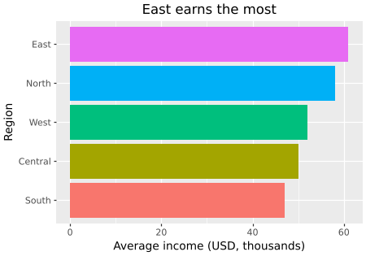 | 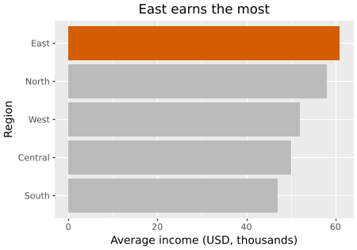 |

Five colors that mean nothing make readers look for a meaning. Spend color on the one bar the title is about.

**What the linter says about the before plot:**

```text
CL203 warning: Each bar gets its own fill from `region`, which the axis already shows, so the colors carry no information.
    fix: Drop `fill='region'` and use one color, e.g. `geom_col(fill='#4C72B0')`.
```

**The fix:**

```diff
- p = (ggplot(income, aes("region", "income", fill="region"))
+ p = (ggplot(income, aes("region", "income", fill="region == 'East'"))
       + geom_col(show_legend=False)
       + coord_flip()
+      + scale_fill_manual(values=["#BBBBBB", OKABE[5]])
       + labs(x="Region", y="Average income (USD, thousands)",
              title="East earns the most"))
```

<details><summary>Data for this example</summary>

```python
income = pd.DataFrame(
    {
        "region": ["West", "East", "South", "North", "Central"],
        "income": [52, 61, 47, 58, 50],
    }
)
income["region"] = pd.Categorical(
    income["region"], categories=income.sort_values("income")["region"]
)
```

</details>

<a id="cl204"></a>

### CL204 — Low-contrast marks

Lines, points and bars that barely differ from the background (pale yellow on white, light gray on gray) disappear for readers with low vision and on projectors.

| Before | After |
| --- | --- |
| 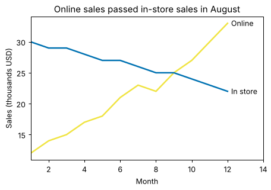 | 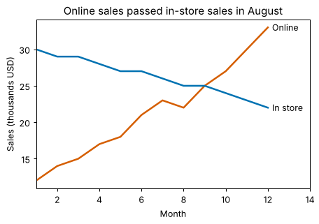 |

Okabe-Ito yellow is only 1.3:1 against white; the vermillion is 3.9:1.

**What the linter says about the before plot:**

```text
CL204 warning: Marks colored #f0e442 have a contrast of only 1.3:1 against the #ffffff background (WCAG asks 3:1).
    fix: Pick a darker color, or outline light fills: `ax.bar(..., edgecolor='#333333')`.
```

**The fix:**

```diff
  fig, ax = plt.subplots()
- ax.plot(sales.month, sales.online, color="#F0E442", linewidth=2)
+ ax.plot(sales.month, sales.online, color=OKABE[5], linewidth=2)
  ax.plot(sales.month, sales.store, color=OKABE[4], linewidth=2)
  ax.text(12.2, 33, "Online", va="center")
  ax.text(12.2, 22, "In store", va="center")
  ax.set(xlabel="Month", ylabel="Sales (thousands USD)", xlim=(1, 14),
         title="Online sales passed in-store sales in August")
  p = fig
```

<details><summary>Data for this example</summary>

```python
sales = pd.DataFrame(
    {
        "month": range(1, 13),
        "online": [12, 14, 15, 17, 18, 21, 23, 22, 25, 27, 30, 33],
        "store": [30, 29, 29, 28, 27, 27, 26, 25, 25, 24, 23, 22],
    }
)
```

</details>

<a id="lb201"></a>

### LB201 — Label is a raw variable name

Column names are code: `avg_income_usd` is how a program refers to the data, not how a reader does.

| Before | After |
| --- | --- |
| 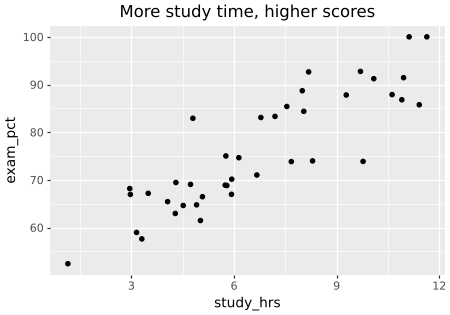 | 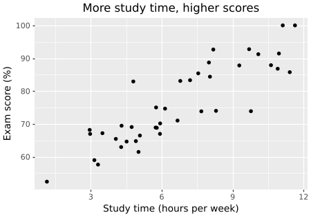 |

**What the linter says about the before plot:**

```text
LB201 warning: The x-axis is labeled `study_hrs`, the raw variable name.
    fix: `+ labs(x='Study (hours)')`
LB201 warning: The y-axis is labeled `exam_pct`, the raw variable name.
    fix: `+ labs(y='Exam (%)')`
```

**The fix:**

```diff
  p = (ggplot(grades, aes("study_hrs", "exam_pct"))
       + geom_point()
+      + labs(x="Study time (hours per week)", y="Exam score (%)",
-      + labs(title="More study time, higher scores"))
+             title="More study time, higher scores"))
```

<details><summary>Data for this example</summary>

```python
n = 40
study_hrs = rng.uniform(1, 12, n)
grades = pd.DataFrame(
    {
        "study_hrs": study_hrs,
        "exam_pct": np.clip(55 + 3 * study_hrs + rng.normal(0, 6, n), 0, 100),
    }
)
```

</details>

<a id="lb203"></a>

### LB203 — Redundant legend

When color repeats what an axis already shows, or a legend has a single entry, the legend adds nothing but asks the reader to look it up anyway.

| Before | After |
| --- | --- |
| 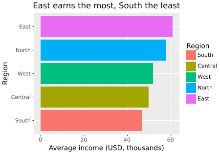 |  |

Five colors that repeat the axis labels send the reader to a legend for nothing.

**What the linter says about the before plot:**

```text
LB203 warning: `region` is mapped to both x and fill, so the legend repeats the x-axis.
    fix: Drop `fill='region'` and use one color (the axis already names each category); save color for another variable or a highlight.
```

**The fix:**

```diff
- p = (ggplot(income, aes("region", "income", fill="region"))
+ p = (ggplot(income, aes("region", "income"))
       + geom_col()
       + coord_flip()
-      + labs(x="Region", y="Average income (USD, thousands)", fill="Region",
+      + labs(x="Region", y="Average income (USD, thousands)",
              title="East earns the most, South the least"))
```

<details><summary>Data for this example</summary>

```python
income = pd.DataFrame(
    {
        "region": ["West", "East", "South", "North", "Central"],
        "income": [52, 61, 47, 58, 50],
    }
)
income["region"] = pd.Categorical(
    income["region"], categories=income.sort_values("income")["region"]
)
```

</details>

<a id="lb205"></a>

### LB205 — Label doesn't match the values

A label that promises percentages over values between 0 and 1, or a proportion over raw counts, tells the reader the wrong scale.

| Before | After |
| --- | --- |
| 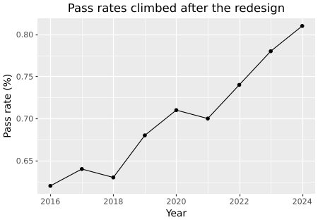 |  |

The label promises percent but the ticks say 0.65 to 0.80; was the pass rate under 1%?

**What the linter says about the before plot:**

```text
LB205 info: The y-axis label says percent ('Pass rate (%)'), but the ticks run 0.65 to 0.8, which look like fractions.
    fix: Multiply by 100, or format ticks as percents (`labels=percent_format()` / `ax.yaxis.set_major_formatter(PercentFormatter(1.0))`).
```

**The fix:**

```diff
- p = (ggplot(exams, aes("year", "rate"))
+ p = (ggplot(exams, aes("year", "rate * 100"))
       + geom_line()
       + geom_point()
       + labs(x="Year", y="Pass rate (%)",
              title="Pass rates climbed after the redesign"))
```

<details><summary>Data for this example</summary>

```python
exams = pd.DataFrame(
    {
        "year": range(2016, 2025),
        "rate": [0.62, 0.64, 0.63, 0.68, 0.71, 0.70, 0.74, 0.78, 0.81],
    }
)
```

</details>

<a id="lb206"></a>

### LB206 — Scientific offset on an axis

An offset like '1e8' in the corner of the axis is easy to miss, so readers misread every tick by orders of magnitude.

| Before | After |
| --- | --- |
|  |  |

The '1e8' at the top of the axis is easy to miss, and without it a reader sees revenue of 3 dollars.

**What the linter says about the before plot:**

```text
LB206 warning: The y-axis ticks are scaled by an easy-to-miss offset '1e8'.
    fix: Divide the values (e.g. by 1e6) and put the unit in the label: `ax.set_ylabel('Revenue (millions USD)')`; or `ax.ticklabel_format(style='plain', axis='y')`.
```

**The fix:**

```diff
  fig, ax = plt.subplots()
- ax.plot(years, revenue, marker="o", color=OKABE[4])
+ ax.plot(years, revenue / 1e6, marker="o", color=OKABE[4])
  ax.set_xlabel("Year")
- ax.set_ylabel("Revenue (USD)")
+ ax.set_ylabel("Revenue (USD, millions)")
  ax.set_title("Revenue more than doubled since 2016")
  p = fig
```

<details><summary>Data for this example</summary>

```python
years = np.arange(2016, 2025)
revenue = np.array([118, 131, 150, 162, 140, 185, 230, 268, 310]) * 1_000_000
```

</details>

<a id="ly201"></a>

### LY201 — Text too small at final size

Small text becomes unreadable once the figure lands in slides, a report or a phone screen.

| Before | After |
| --- | --- |
|  |  |

**What the linter says about the before plot:**

```text
LY201 warning: Some text is 4.8 pt, below 8 pt (other, xtick, ytick).
    fix: `+ theme(text=element_text(size=11))` or a larger `base_size` in the theme, e.g. `theme_bw(base_size=12)`.
```

**The fix:**

```diff
  p = (ggplot(income, aes("reorder(region, income)", "income"))
       + geom_col()
       + coord_flip()
-      + theme_gray(base_size=6)
+      + theme_gray(base_size=11)
       + labs(x="Region", y="Average income (USD, thousands)",
              title="East earns the most, South the least"))
```

<details><summary>Data for this example</summary>

```python
income = pd.DataFrame(
    {
        "region": ["West", "East", "South", "North", "Central"],
        "income": [52, 61, 47, 58, 50],
    }
)
```

</details>

<a id="ly202"></a>

### LY202 — Legend order doesn't match line order

When the top legend entry isn't the top line, readers hunt back and forth between lines and legend to match them up.

| Before | After |
| --- | --- |
|  |  |

Ordering the categories by each line's final value makes the legend read top to bottom like the lines.

**What the linter says about the before plot:**

```text
LY202 warning: The legend lists `language` as C++, Java, JavaScript, Python…, but the lines end in a different top-to-bottom order.
    fix: Make `language` a Categorical ordered by each line's last value (highest first), or label line ends with `geom_text` and drop the legend.
```

**The fix:**

```diff
+ by_last = ["Python", "JavaScript", "Java", "C++", "R"]
+ langs["language"] = pd.Categorical(langs["language"], categories=by_last)
  p = (ggplot(langs, aes("year", "share", color="language"))
       + geom_line(size=1)
       + scale_color_manual(values=[OKABE[i] for i in (0, 1, 2, 4, 5)])
       + labs(x="Year", y="Share of job ads (%)", color="Language",
              title="Python overtook Java in 2020"))
```

<details><summary>Data for this example</summary>

```python
langs = pd.DataFrame(
    {
        "year": np.tile(np.arange(2016, 2025), 5),
        "language": np.repeat(["C++", "Java", "JavaScript", "Python", "R"], 9),
        "share": [
            12,
            11,
            11,
            10,
            10,
            9,
            9,
            8,
            8,
            26,
            25,
            23,
            21,
            19,
            18,
            16,
            15,
            14,
            20,
            21,
            21,
            22,
            22,
            21,
            21,
            20,
            20,
            10,
            13,
            16,
            19,
            22,
            25,
            27,
            29,
            31,
            5,
            5,
            6,
            6,
            6,
            6,
            5,
            5,
            5,
        ],
    }
)
```

</details>

<a id="mk201"></a>

### MK201 — Pie with many slices

People compare angles and areas poorly; past a few slices, a pie can't show which parts are bigger.

| Before | After |
| --- | --- |
|  |  |

Is Transport bigger than Fun? The pie can't say; the sorted bars can.

**What the linter says about the before plot:**

```text
MK201 warning: This pie has 7 slices (more than 4).
    fix: `s.sort_values().plot.barh()` shows the same parts in a readable order.
```

**The fix:**

```diff
+ s = budget.sort_values()
  fig, ax = plt.subplots()
- ax.pie(budget, labels=budget.index)
- ax.set_title("Where a monthly budget goes")
+ ax.barh(s.index, s.values, color=OKABE[4])
+ ax.set_xlabel("Monthly spending (USD)")
+ ax.set_title("Rent costs more than food, transport and fun combined")
  p = fig
```

<details><summary>Data for this example</summary>

```python
budget = pd.Series(
    {
        "Rent": 1600,
        "Food": 650,
        "Transport": 300,
        "Utilities": 180,
        "Health": 220,
        "Fun": 250,
        "Savings": 400,
    }
)
```

</details>

<a id="mk202"></a>

### MK202 — Spaghetti lines

Past about seven lines, lines tangle and colors can't be matched to the legend.

| Before | After |
| --- | --- |
|  |  |

Ten colors can't be matched to a legend. Small multiples on a shared scale give each state its own panel.

**What the linter says about the before plot:**

```text
MK202 warning: One panel draws 10 differently colored lines (more than 7).
    fix: Gray most lines and color a few, or `facet_wrap('state')`.
```

The before plot also trips [AX207](#ax207), [CL102](#cl102), [CL201](#cl201), [LY202](#ly202).

**The fix:**

```diff
- p = (ggplot(solar, aes("year", "share", color="state"))
+ p = (ggplot(solar, aes("year", "share"))
-      + geom_line()
+      + geom_line(color=OKABE[4])
+      + facet_wrap("state", ncol=5)
+      + scale_x_continuous(breaks=[2016, 2023], labels=["'16", "'23"])
-      + labs(x="Year", y="Solar share of electricity (%)", color="State",
+      + labs(x="Year", y="Solar share of electricity (%)",
              title="Solar grew everywhere, fastest in CA and NV"))
```

<details><summary>Data for this example</summary>

```python
states = ["CA", "TX", "NV", "AZ", "NC", "FL", "NY", "MA", "CO", "UT"]
solar = pd.DataFrame(
    {
        "year": np.tile(np.arange(2015, 2025), 10),
        "state": np.repeat(states, 10),
        "share": np.concatenate(
            [
                np.linspace(a, b, 10) + rng.normal(0, 0.4, 10)
                for a, b in zip(
                    [8, 1, 5, 4, 2, 1, 1, 2, 2, 2], [28, 7, 26, 16, 9, 7, 5, 9, 9, 10]
                )
            ]
        ).round(1),
    }
)
```

</details>

<a id="mk203"></a>

### MK203 — Summary bars without uncertainty

A bar of means hides spread and sample size: two groups with the same mean can differ wildly in their data.

| Before | After |
| --- | --- |
|  |  |

The bars hide that the sleep-deprived group is far more variable; the points and confidence intervals show it.

**What the linter says about the before plot:**

```text
MK203 warning: Bars show a summary statistic with no error bars or data points.
    fix: Add `stat_summary(geom='errorbar', fun_data='mean_cl_normal', width=0.2)` or `geom_jitter(width=0.15, alpha=0.4)`.
```

**The fix:**

```diff
  p = (ggplot(rt, aes("condition", "ms"))
-      + stat_summary(geom="bar", fun_y=np.mean)
+      + geom_jitter(width=0.15, height=0, alpha=0.5)
+      + stat_summary(fun_data="mean_cl_normal", color=OKABE[5])
       + coord_flip()
-      + labs(x="Condition", y="Mean reaction time (ms)",
+      + labs(x="Condition", y="Reaction time (ms)",
-             title="Sleep loss slows reactions"))
+             title="Sleep loss slows reactions",
+             caption="Points: participants. Orange: mean and 95% CI."))
```

<details><summary>Data for this example</summary>

```python
n = 15
conditions = ["Rested", "Sleep-deprived", "Sleep-deprived + caffeine"]
rt = pd.DataFrame(
    {
        "condition": pd.Categorical(
            np.repeat(conditions, n), categories=conditions, ordered=True
        ),
        "ms": np.concatenate(
            [rng.normal(m, s, n) for m, s in ((310, 25), (380, 60), (360, 45))]
        ),
    }
)
```

</details>

<a id="mk204"></a>

### MK204 — Box plot hides small groups

A box plot summarizes a distribution with five numbers.

| Before | After |
| --- | --- |
|  |  |

The tablet box looks as solid as the others but summarizes six sessions.

**What the linter says about the before plot:**

```text
MK204 warning: Some boxes summarize fewer than 10 observations (smallest: `Tablet`, n = 6).
    fix: Add the points: `+ geom_jitter(width=0.15, alpha=0.6)`, and consider showing n per group.
```

**The fix:**

```diff
  p = (ggplot(sessions, aes("device", "minutes"))
-      + geom_boxplot()
+      + geom_boxplot(outlier_shape="")
+      + geom_jitter(width=0.15, height=0, alpha=0.5)
       + labs(x="Device", y="Session length (minutes)",
-             title="Desktop sessions run longest"))
+             title="Desktop sessions run longest",
+             caption="Only 6 tablet sessions were recorded."))
```

<details><summary>Data for this example</summary>

```python
sessions = pd.DataFrame(
    {
        "device": ["Desktop"] * 40 + ["Phone"] * 40 + ["Tablet"] * 6,
        "minutes": np.concatenate(
            [rng.gamma(5, 4, 40), rng.gamma(3, 3, 40), rng.gamma(4, 4, 6)]
        ),
    }
)
```

</details>

<a id="mk205"></a>

### MK205 — Stacked bars with many segments

Only the bottom segment of a stacked bar shares a baseline.

| Before | After |
| --- | --- |
|  |  |

In the stack, only Car shares a baseline; compare Rail across cities and you are comparing floating segments.

**What the linter says about the before plot:**

```text
MK205 warning: Bars stack 7 segments of `mode`; only the bottom one can be compared across bars.
    fix: Use `position='dodge'`, or `facet_wrap('mode')`, or lump small levels into 'Other'.
```

The before plot also trips [CL201](#cl201).

**The fix:**

```diff
- p = (ggplot(commute, aes("city", "share", fill="mode"))
+ p = (ggplot(commute, aes("reorder(mode, share)", "share"))
       + geom_col()
+      + coord_flip()
+      + facet_wrap("city")
-      + labs(x="City", y="Share of commuters (%)", fill="Mode",
+      + labs(x="Mode", y="Share of commuters (%)",
              title="Chicago relies least on cars"))
```

<details><summary>Data for this example</summary>

```python
modes = ["Car", "Bus", "Rail", "Bike", "Walk", "Scooter", "Other"]
commute = pd.DataFrame(
    {
        "city": np.repeat(["Austin", "Chicago", "Portland"], 7),
        "mode": modes * 3,
        "share": [
            72,
            4,
            1,
            2,
            3,
            1,
            17,
            48,
            13,
            15,
            2,
            7,
            1,
            14,
            58,
            9,
            3,
            6,
            6,
            1,
            17,
        ],
    }
)
```

</details>

## Tier 3: Style (info, opt-in)

<a id="cl301"></a>

### CL301 — Color is the only cue

Charts get printed in grayscale and read by people with low vision.

| Before | After |
| --- | --- |
|  |  |

Okabe-Ito orange and sky blue are CVD-safe but print as the same gray; a linetype keeps them apart.

**What the linter says about the before plot:**

```text
CL301 info: `light` is shown by color alone, and in grayscale 'Full sun' and 'Shade' look the same.
    fix: Also map `shape='light'` (points) or `linetype='light'` (lines), or label the groups directly with `geom_text`.
```

**The fix:**

```diff
+ last = growth[growth["day"] == 9]
- p = (ggplot(growth, aes("day", "height", color="light"))
+ p = (ggplot(growth, aes("day", "height", color="light", linetype="light"))
       + geom_line(size=1)
+      + geom_text(aes(label="light"), data=last, ha="left", nudge_x=0.2, color="#222222")
       + scale_color_manual(values=[OKABE[0], OKABE[1]])
-      + scale_x_continuous(breaks=range(0, 10, 3))
+      + scale_x_continuous(breaks=range(0, 10, 3), limits=(0, 11.5))
+      + theme(legend_position="none")
-      + labs(x="Day", y="Seedling height (cm)", color="Light",
+      + labs(x="Day", y="Seedling height (cm)",
              title="Seedlings in full sun grew almost twice as fast"))
```

<details><summary>Data for this example</summary>

```python
t = np.arange(0, 10)
growth = pd.DataFrame(
    {
        "day": np.tile(t, 2),
        "height": np.r_[2 + 1.1 * t, 2 + 0.6 * t],
        "light": np.repeat(["Full sun", "Shade"], len(t)),
    }
)
```

</details>

<a id="lb301"></a>

### LB301 — Quantitative label has no units

A number without units can't be interpreted: is that dollars or thousands of dollars, seconds or minutes?

| Before | After |
| --- | --- |
|  |  |

Is 61 dollars, thousands of dollars, or an index? This rule is a heuristic, so it is reported as info.

**What the linter says about the before plot:**

```text
LB301 info: The x-axis label 'Average income' doesn't mention units.
    fix: `labs(x='Average income (units)')`, if the measure has units.
```

**The fix:**

```diff
  p = (ggplot(income, aes("reorder(region, income)", "income"))
       + geom_col()
       + coord_flip()
-      + labs(x="Region", y="Average income",
+      + labs(x="Region", y="Average income (USD, thousands)",
              title="East earns the most, South the least"))
```

<details><summary>Data for this example</summary>

```python
income = pd.DataFrame(
    {
        "region": ["West", "East", "South", "North", "Central"],
        "income": [52, 61, 47, 58, 50],
    }
)
```

</details>

<a id="st301"></a>

### ST301 — No title

A figure that travels without its surrounding text (a slide, a report, a screenshot) needs its own context.

| Before | After |
| --- | --- |
|  |  |

**What the linter says about the before plot:**

```text
ST301 info: The plot has no title.
    fix: `+ labs(title='What the reader should take away')`
```

**The fix:**

```diff
  p = (ggplot(bikes, aes("temp", "rentals"))
       + geom_point()
-      + labs(x="Temperature (°C)", y="Daily bike rentals (count)"))
+      + labs(x="Temperature (°C)", y="Daily bike rentals (count)",
+             title="Rentals climb as days warm up"))
```

<details><summary>Data for this example</summary>

```python
n = 40
temp = rng.uniform(2, 32, n)
bikes = pd.DataFrame(
    {"temp": temp, "rentals": (800 + 120 * temp + rng.normal(0, 400, n)).round()}
)
```

</details>

<a id="st303"></a>

### ST303 — Direct labels would beat a legend

With a few lines, labeling each line end removes the back-and-forth between lines and legend.

| Before | After |
| --- | --- |
|  |  |

**What the linter says about the before plot:**

```text
ST303 info: 3 lines are matched to a legend.
    fix: Label line ends with `geom_text` on the last point per group, then `+ theme(legend_position='none')`.
```

The before plot also trips [AX207](#ax207).

**The fix:**

```diff
+ last = homes[homes["year"] == 2024]
  p = (ggplot(homes, aes("year", "price", color="city"))
       + geom_line(size=1)
+      + geom_text(aes(label="city"), data=last, ha="left", nudge_x=0.2, size=10,
+                  color="#222222")  # dark text: colored labels can fail text contrast
       + scale_color_manual(values=OKABE[:3])
+      + scale_x_continuous(limits=(2015, 2026.5), breaks=range(2015, 2025, 3))
+      + theme(legend_position="none")
-      + labs(x="Year", y="Median home price (USD, thousands)", color="City",
+      + labs(x="Year", y="Median home price (USD, thousands)",
              title="San Diego prices pulled away after 2020"))
```

<details><summary>Data for this example</summary>

```python
homes = pd.DataFrame(
    {
        "year": np.tile(np.arange(2015, 2025), 3),
        "city": pd.Categorical(
            np.repeat(["San Diego", "Denver", "Phoenix"], 10),
            categories=["San Diego", "Denver", "Phoenix"],
        ),
        "price": [
            480,
            510,
            545,
            570,
            600,
            650,
            760,
            850,
            880,
            930,
            380,
            410,
            440,
            460,
            480,
            510,
            600,
            650,
            620,
            610,
            210,
            230,
            250,
            270,
            290,
            320,
            410,
            460,
            430,
            440,
        ],
    }
)
```

</details>

<a id="st305"></a>

### ST305 — Same category, different colors across figures

Readers carry color meaning from one figure to the next.

| Before (two figures in one notebook) | After (two figures in one notebook) |
| --- | --- |
|  |  |

Two figures from one notebook, linted with a shared `Session` (`lint(fig, session=session)`; the Jupyter hook does this for you). A list of colors is handed out in order, so when the second figure keeps only South and West, South turns orange and West sky blue. A dict ties each region to one color in every figure.

**What the linter says about the before plot:**

```text
ST305 info: 'South' is #e69f00 here but was #009e73 in figure 1 of this notebook.
    fix: Make one mapping, e.g. `palette = {'South': '#009e73', ...}`, and pass it to every plot (`scale_color_manual(values=palette)` / `palette=palette` in seaborn).
```

**The fix:**

```diff
- PAL = [OKABE[i] for i in (0, 1, 2, 4)]
+ PAL = dict(zip(["East", "North", "South", "West"], [OKABE[i] for i in (0, 1, 2, 4)]))
  figs = [scatter(stores, "Ads pay off in every region") + scale_color_manual(values=PAL),
          scatter(south_west, "South and West stores") + scale_color_manual(values=PAL)]
```

<details><summary>Data for this example</summary>

```python
n = 15
stores = pd.DataFrame(
    {
        "region": np.repeat(["East", "North", "South", "West"], n),
        "ads": rng.uniform(5, 40, 4 * n),
    }
)
stores["revenue"] = (60 + 4 * stores["ads"] + rng.normal(0, 20, 4 * n)).round()
south_west = stores[stores["region"].isin(["South", "West"])]


def scatter(df, title):
    return (
        ggplot(df, aes("ads", "revenue", color="region"))
        + geom_point()
        + labs(x="Ad spend (USD, k)", y="Revenue (USD, k)", color="Region", title=title)
    )
```

</details>

<a id="st306"></a>

### ST306 — Inconsistent themes across figures

Figures in one report read as a set.

| Before (two figures in one notebook) | After (two figures in one notebook) |
| --- | --- |
|  |  |

Two figures from one notebook, linted with a shared `Session`. The first got `theme_minimal()`, the second was left on the default gray theme, so the pair looks unfinished. `theme_set()` once at the top of the notebook styles every figure the same way.

**What the linter says about the before plot:**

```text
ST306 info: This figure's theme (theme_gray) differs from the first figure's (theme_minimal).
    fix: Set it once at the top: `theme_set(theme_minimal())` (plotnine) or `sns.set_theme(...)` / `plt.style.use(...)` (matplotlib).
```

**The fix:**

```diff
+ theme_set(theme_minimal())
  figs = [ggplot(income, aes("reorder(region, income)", "income")) + geom_col() + coord_flip()
-         + theme_minimal()
          + labs(x="Region", y="Income (USD, k)", title="East earns the most"),
          ggplot(trend, aes("year", "income")) + geom_line()
          + scale_x_continuous(breaks=range(2015, 2025, 3))
          + labs(x="Year", y="Income (USD, k)", title="Incomes rose 27% since 2015")]
```

<details><summary>Data for this example</summary>

```python
income = pd.DataFrame(
    {
        "region": ["West", "East", "South", "North", "Central"],
        "income": [52, 61, 47, 58, 50],
    }
)
trend = pd.DataFrame(
    {"year": range(2015, 2025), "income": [44, 45, 47, 48, 50, 49, 51, 53, 55, 56]}
)
```

</details>

<a id="st307"></a>

### ST307 — Excess precision in tick labels

Extra decimals add clutter without information.

| Before | After |
| --- | --- |
|  |  |

`0.035, 0.040, 0.045` makes the reader do arithmetic; `3.5%, 4.0%, 4.5%` says the same with fewer digits.

**What the linter says about the before plot:**

```text
ST307 info: y-axis tick labels show 3+ decimal places.
    fix: Round tick labels, e.g. `scale_y_continuous(labels=lambda v: [f'{x:.1f}' for x in v])`
```

**The fix:**

```diff
  p = (ggplot(jobs, aes("year", "rate"))
       + geom_line()
       + scale_x_continuous(breaks=range(2015, 2025, 3))
+      + scale_y_continuous(labels=label_percent())
-      + labs(x="Year", y="Unemployment rate (share of workers)",
+      + labs(x="Year", y="Unemployment rate (%)",
              title="Unemployment drifted down"))
```

<details><summary>Data for this example</summary>

```python
jobs = pd.DataFrame(
    {
        "year": range(2015, 2025),
        "rate": [0.046, 0.043, 0.041, 0.038, 0.035, 0.037, 0.039, 0.036, 0.034, 0.033],
    }
)
```

</details>
